# Webプログラミング レポート：基本的なデータ表示のWebアプリ開発
# スプラトゥーン3 データ参照システム 仕様書

- 所属：情報変革科学部 情報工学科
- 学籍番号：26G1118
- 氏名：三部楓侑
- 作成日：2026年11月

## 目次

1. [はじめに](#1-はじめに)
2. [利用者向け仕様書（ブキ参照システム）](#2-利用者向け仕様書ブキ参照システム)
3. [管理者向け仕様書](#3-管理者向け仕様書)
4. [開発者向け仕様書](#4-開発者向け仕様書)
   - [4.1 共通の設計](#41-共通の設計)
   - [4.2 ブキ参照システム](#42-ブキ参照システム)
   - [4.3 ギア参照システム](#43-ギア参照システム)
   - [4.4 ステージ参照システム](#44-ステージ参照システム)
5. [授業で説明していない技術](#5-授業で説明していない技術)
6. [参考にしたデータ](#参考にしたデータ)

---

## 1. はじめに

このレポートでは，授業で作った京葉線データベースアプリ（keiyo2）と同じく，一覧表示をベースとしたWebアプリケーションを3つ開発した．どれもゲーム『スプラトゥーン3』のデータを参照するシステムである．

1. **ブキ参照システム**：ブキ（武器）ごとに武器種，サブウェポン，スペシャルウェポンを参照する．武器種・サブ・スペシャルで並べ替えられる．
2. **ギア参照システム**：ギア（装備）ごとに部位，ブランド，ギアの効果（メインギアパワー）を参照する．ブランド・ギアの効果で並べ替えられる．
3. **ステージ参照システム**：バトルステージごとに初登場作品，スプラトゥーン3への追加時期，特徴を参照する．

3つのシステムは1つのサーバプログラム（`splatoon.js`）で動く．REST APIによる統一した操作で，データの一覧表示・詳細表示・追加・削除・変更ができる．データはプログラム内の変数（配列）に記録する．

| 項目 | 内容 |
|---|---|
| ソースコード | https://github.com/kaede32340519-art/webpro_06 |
| サーバプログラム | `splatoon.js`（先頭に `"use strict";` を記述） |

この仕様書は，利用者向け（第2節），管理者向け（第3節），開発者向け（第4節）の3部構成である．
- 利用者向け：代表としてブキ参照システムについて書く
- 管理者向け：3つのシステムを1つのシステムとしてまとめて書く
- 開発者向け：システムごとに書く

---

## 2. 利用者向け仕様書（ブキ参照システム）

### 2.1 このシステムでできること

スプラトゥーン3のブキについて，次のことができる．

- ブキの一覧を見る．武器種・サブウェポン・スペシャルウェポンの順に並べ替える．
- ブキの詳細（武器種・サブ・スペシャル）を見る．
- 新しいブキを登録する．登録済みのブキの内容を変更する．ブキを削除する．

ギア参照システムとステージ参照システムも，画面の名前が変わるだけで，同じ手順で使える．

### 2.2 使い始め方

Webブラウザで `http://localhost:8080/` を開くと，トップページ（図1）が表示される．「ブキ参照システム」をクリックすると，ブキ一覧が表示される．どの画面でも，上のメニューから「トップ」「ブキ」「ギア」「ステージ」に移動できる．

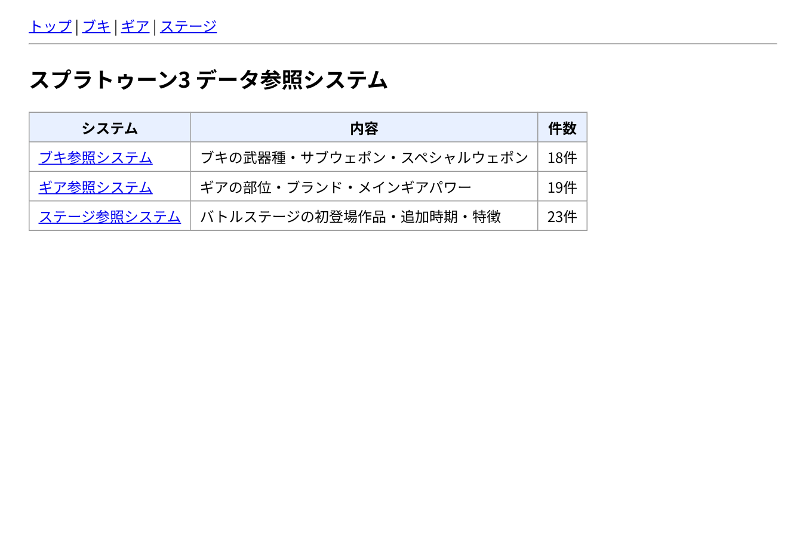

*図1 トップページ*

### 2.3 ブキの一覧を見る・並べ替える

ブキ一覧（図2）には，登録されているすべてのブキが表示される．

「並べ替え：」の右にある「武器種」「サブ」「スペシャル」をクリックすると，その項目の順に並べ替わる（図3）．表の見出しをクリックしても同じように並べ替わる．並び順は次の通りである．

- 武器種：シューター，ローラー，チャージャー…の順
- サブ・スペシャル：ゲーム内の一覧に近い順
- 同じ値どうしはID順

今どの項目で並べ替えているかは，太字で表示される．「ID順」をクリックすると元の順番に戻る．

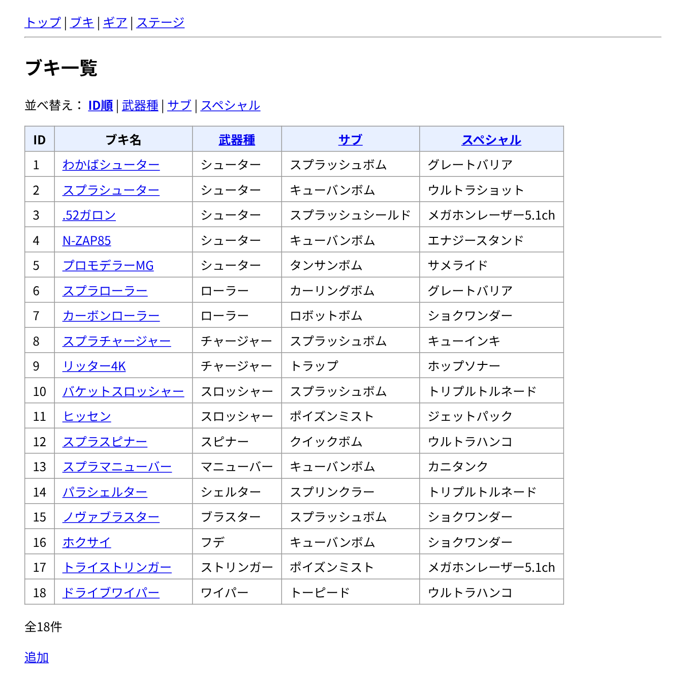

*図2 ブキ一覧（ID順）*

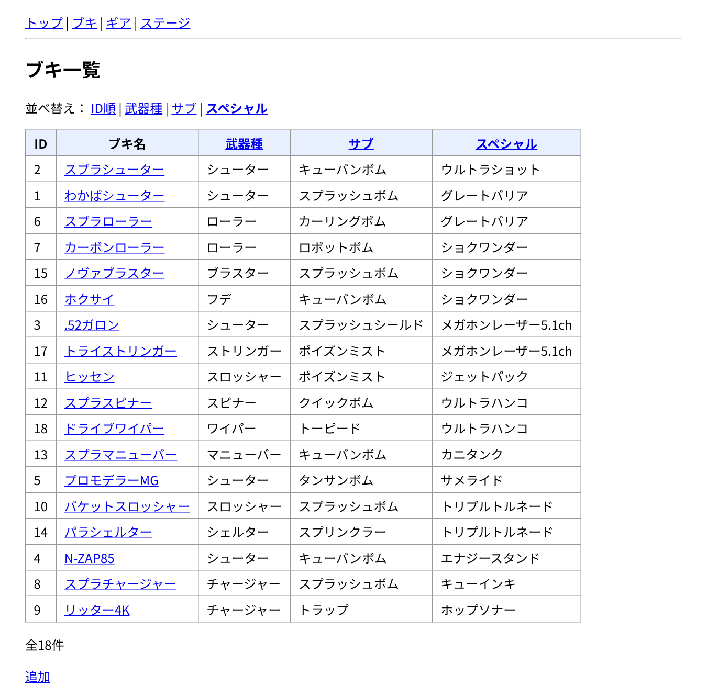

*図3 スペシャルで並べ替えたブキ一覧*

### 2.4 ブキの詳細を見る

一覧のブキ名をクリックすると，そのブキの詳細（図4）が表示される．

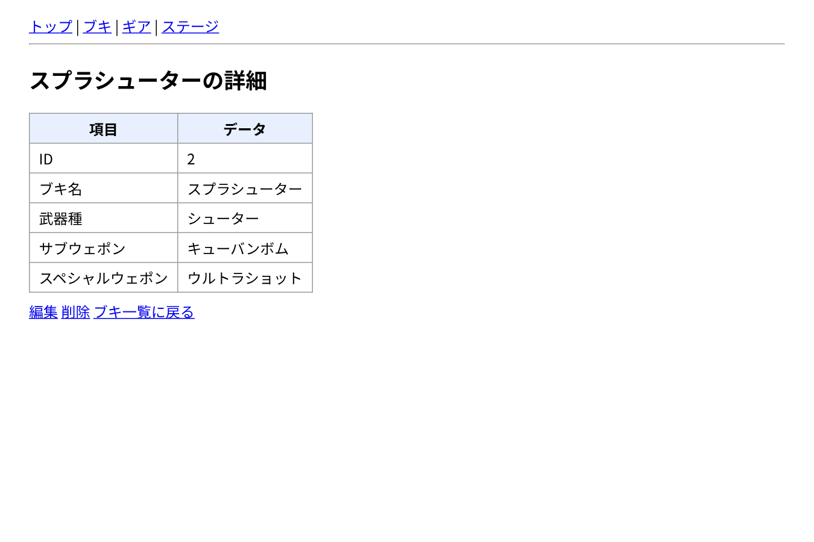

*図4 ブキの詳細*

### 2.5 ブキを登録する

一覧の下の「追加」をクリックすると，新規登録の画面（図5）が表示される．

1. ブキ名を入力する（必ず入力すること）．
2. 武器種・サブウェポン・スペシャルウェポンをプルダウンから選ぶ．
3. 「登録」を押す．

一覧に追加され，IDは自動で付けられる．

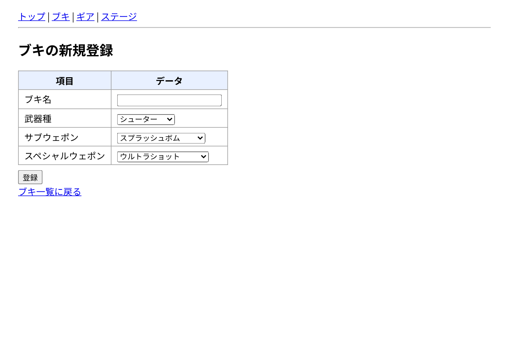

*図5 ブキの新規登録*

### 2.6 ブキの内容を変更する

詳細画面の「編集」をクリックすると，今の内容が入った編集画面（図6）が表示される．内容を変更して「更新」を押すと，変更後の詳細画面に戻る．

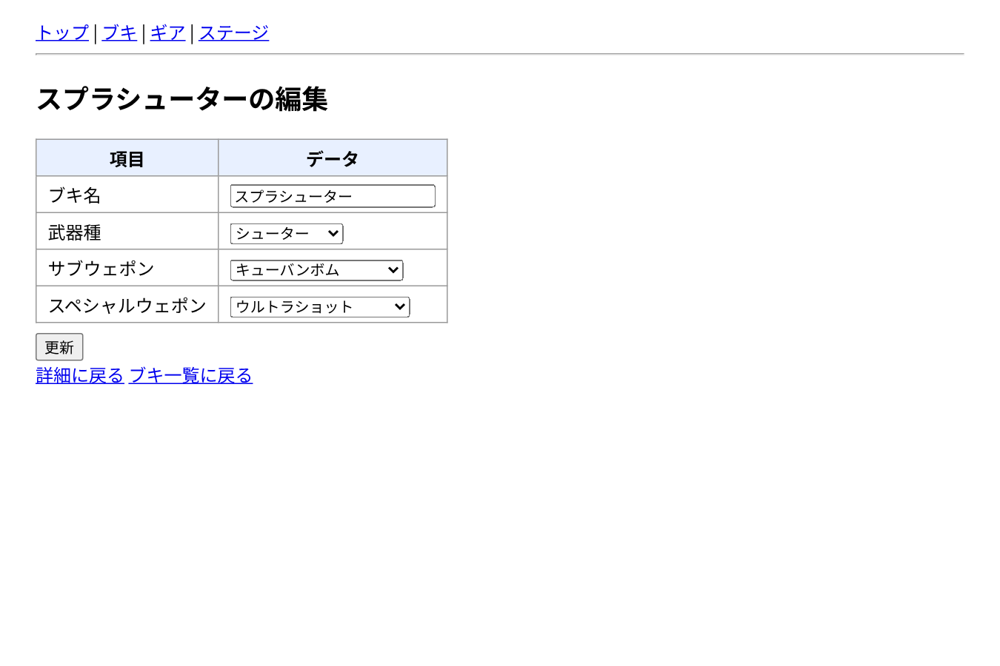

*図6 ブキの編集*

### 2.7 ブキを削除する

詳細画面の「削除」をクリックすると，確認のメッセージが表示される．「OK」を押すと削除され，一覧に戻る．**削除したブキは元に戻せないので注意すること．**

### 2.8 注意

- 登録・変更・削除した内容は，サーバを再起動すると最初の状態に戻る．
- 存在しないブキのURLを開くと「指定されたデータは存在しません」と表示される（図7）．「ブキ一覧に戻る」から一覧に戻ること．

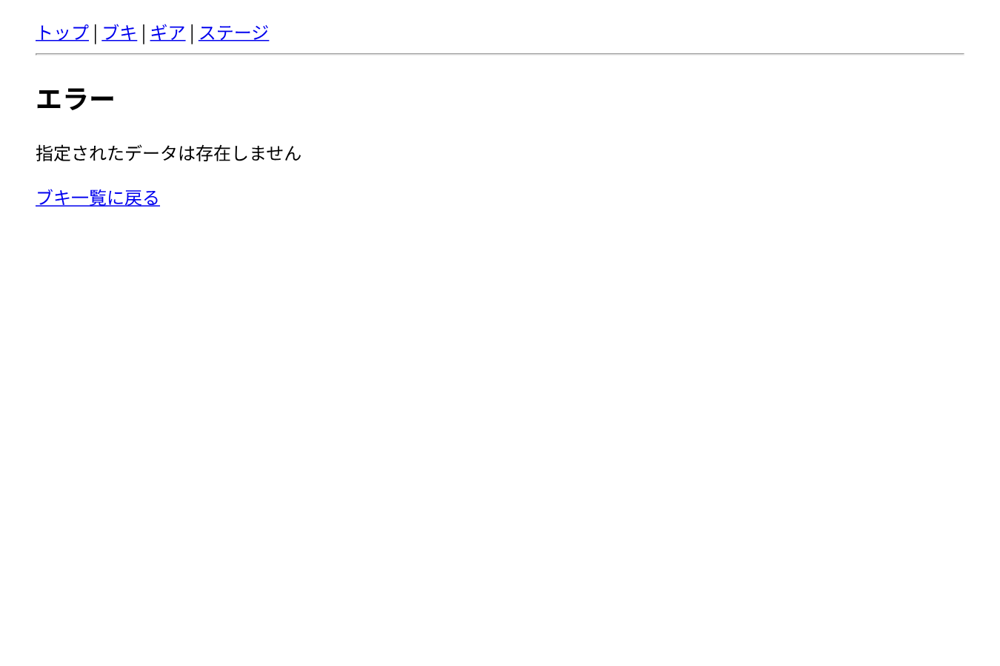

*図7 存在しないデータを開いたとき*

---

## 3. 管理者向け仕様書

3つのシステムは1つのサーバプログラムで動くため，管理者からは1つのシステムとして扱える．

### 3.1 動作環境

- Node.js（動作確認：v22）
- npmパッケージ：express（v4），ejs（v3）（`package.json` に記載）
- Webブラウザ（Chrome，Safari，Firefox など）

### 3.2 インストール

```
$ git clone https://github.com/kaede32340519-art/webpro_06.git
$ cd webpro_06
$ npm install
```

### 3.3 起動と停止

```
$ node splatoon.js
Example app listening on port 8080!
```

- 起動したら `http://localhost:8080/` で使える．
- 停止するときは，ターミナルで Ctrl+C を押す．
- ポート8080を別のプログラムが使っていると起動できない．そのプログラムを止めてから起動する．
- ポート番号を変えたいときは，`splatoon.js` の最終行 `app.listen(8080, ...)` の数字を変える．

### 3.4 提供するURL

`XXX` には weapon，gear，stage のどれかが入る．`:number` は一覧での並び（0から始まる配列の番号）である．

| メソッド | リソース名 | 機能 |
|---|---|---|
| GET | `/` | トップページ |
| GET | `/XXX` | 一覧表示（weapon と gear は `?sort=` で並べ替え） |
| GET | `/XXX/create` | 新規登録フォーム |
| POST | `/XXX` | 新規登録処理 |
| GET | `/XXX/:number` | 詳細表示 |
| GET | `/XXX/edit/:number` | 編集フォーム |
| POST | `/XXX/update/:number` | 更新処理 |
| GET | `/XXX/delete/:number` | 削除処理 |

### 3.5 データの管理

- データは `splatoon.js` の中の配列 `weapon`，`gear`，`stage` に記録している．データベースは使っていない．そのため，**サーバを止めたり再起動したりすると，利用者が登録・変更・削除した内容はすべて初期データに戻る**．
- 初期データを変えるときは，これらの配列を直接書き換えてから，サーバを再起動する．
- 登録フォームのプルダウンの選択肢は，`splatoon.js` の最初のほうにある配列で管理している（下の表）．ゲームのアップデートで新しいサブ・スペシャル・ギアパワーなどが増えたら，この配列に追加する．配列の順番が，そのまま並べ替えの順番になる．

| 配列 | 内容 |
|---|---|
| `WEAPON_TYPES` | 武器種（11種） |
| `SUBS` | サブウェポン（14種） |
| `SPECIALS` | スペシャルウェポン（19種） |
| `GEAR_PARTS` | ギアの部位（アタマ・フク・クツ） |
| `BRANDS` | ブランド（20種） |
| `ABILITIES` | メインギアパワー（26種） |
| `ORIGINS` | ステージの初登場作品（3作品） |

### 3.6 ファイル構成

| ファイル | 内容 |
|---|---|
| `splatoon.js` | サーバプログラム（3システム共通） |
| `public/splatoon.css` | 共通のスタイルシート |
| `views/sp_top.ejs` | トップページ |
| `views/sp_menu.ejs` | 全ページ共通のメニュー |
| `views/sp_error.ejs` | 存在しないデータを開いたときのページ |
| `views/weapon*.ejs` | ブキ参照システムのページ（5ファイル） |
| `views/gear*.ejs` | ギア参照システムのページ（5ファイル） |
| `views/stage*.ejs` | ステージ参照システムのページ（5ファイル） |

### 3.7 トラブルのときは

| 症状 | 原因と対処 |
|---|---|
| `Error: Cannot find module 'express'` と表示される | `npm install` をしていない．実行してから起動する． |
| `EADDRINUSE` と表示される | ポート8080が使われている．ほかのサーバを止める． |
| データがおかしくなった | サーバを再起動すると初期データに戻る． |

---

## 4. 開発者向け仕様書

### 4.1 共通の設計

#### 4.1.1 リソース名とページ遷移の統一

3つのシステムで違うのは，リソース名（`/weapon`，`/gear`，`/stage`）の部分だけである．それより後ろのURLの形，HTTPメソッド，ページ遷移はすべて同じにした（3.4節の表）．

授業の keiyo2 と同じく，一覧・詳細・新規登録・編集の各ページはGETで表示する．データを変える新規登録処理と更新処理はPOSTで受け取る．POSTのリクエストボディを `req.body` で受け取るために，`app.use(express.urlencoded({ extended: true }))` を設定している．

授業の keiyo2 から変えた点は次の通り．

- **新規登録フォームをEJSにした**
  keiyo2 では `/keiyo2/create` から静的なHTMLにリダイレクトしていた．このシステムでは，プルダウンの選択肢をプログラム内の配列から作るため，`/XXX/create` でEJSのテンプレートを表示する．リソース名は keiyo2 と同じである．
- **新規登録や更新のあとはリダイレクトする**
  POSTの結果をそのまま表示すると，再読み込みしたときに同じデータが二重に登録されてしまう．そこで，新規登録処理のあとは一覧へ，更新処理のあとは詳細へリダイレクトする．
- **番号をチェックする**
  `:number` が数字でないときや，配列の範囲外のときは，404のエラーページを表示する（関数 `checkNumber`）．
- **IDの付け方を変えた**
  keiyo2 の「件数+1」だと，削除したあとに登録するとIDが重なる．このシステムでは「今あるIDの最大値+1」とした（関数 `newId`）．
- **編集フォームの送り先を変えた**
  keiyo2 では `data.id - 1` を使っていた．しかし削除したあとはIDと配列の番号がずれるため，配列の番号 `id` を使う．

#### 4.1.2 共通の関数

| 関数 | 説明 |
|---|---|
| `checkNumber(number, data)` | URLの `:number` が配列の番号として正しければその数値を，正しくなければ -1 を返す． |
| `notFound(res, back, title)` | ステータスコード404でエラーページを返す． |
| `newId(data)` | 配列の中のIDの最大値+1を返す． |
| `sortList(data, key, order)` | 一覧表示用に並べ替えた配列を返す（4.1.3節）． |

#### 4.1.3 並べ替えの仕組み

一覧のURLに `?sort=項目名` を付けると，`req.query.sort` で項目名を受け取り，その項目で並べ替えて表示する．

並べ替えると，表示の順番と配列の順番が変わる．そのまま `/XXX/番号` のリンクを作ると，別のデータの詳細が開いてしまう．そこで `sortList` では，各データに元の配列の番号 `index` を付けてから並べ替える．テンプレートでは，リンクに `index` を使う．元の配列（`weapon` など）は並べ替えない．

並び順は次のように決めた．

- 選択肢の配列（`order`）が渡されたとき：その配列の中の位置の順
- 渡されないとき：`localeCompare` による五十音順
- 値が同じとき：ID順
- 許可していない項目名が指定されたとき：ID順で表示する

ギアパワーには「復活時間短縮」のように漢字を含むものがある．五十音順にすると，読みではなく文字コードの順になってしまう．そのため，ギアパワーはゲーム内の順番（配列 `ABILITIES`）で並べる．

```javascript
// sortList（抜粋）
function sortList( data, key, order ) {
  let list = [];
  for( let i = 0; i < data.length; i++ ) {
    list.push( { index: i, row: data[i] } );
  }
  if( key ) {
    list.sort( (a, b) => {
      let result;
      if( order ) {
        result = order.indexOf( a.row[key] ) - order.indexOf( b.row[key] );
      } else {
        result = String( a.row[key] ).localeCompare( String( b.row[key] ), 'ja' );
      }
      if( result == 0 ) result = a.row.id - b.row.id;
      return result;
    });
  }
  return list;
}
```

#### 4.1.4 テンプレートの構成

各システムのテンプレートは，同じ名前の付け方で5つずつ用意した．

| テンプレート | 使うページ |
|---|---|
| `XXX.ejs` | 一覧 |
| `XXX_detail.ejs` | 詳細 |
| `XXX_new.ejs` | 新規登録フォーム |
| `XXX_edit.ejs` | 編集フォーム |
| `XXX_form.ejs` | 新規登録と編集で共通の入力欄（`include` で読み込む） |

---

### 4.2 ブキ参照システム

#### 4.2.1 データ構造

配列 `weapon` の各要素は，次のオブジェクトである．初期データは18件．

| プロパティ | 型 | 内容 | 例 |
|---|---|---|---|
| `id` | 数値 | ID（自動で付ける） | 2 |
| `name` | 文字列 | ブキ名 | スプラシューター |
| `type` | 文字列 | 武器種（`WEAPON_TYPES` から選ぶ） | シューター |
| `sub` | 文字列 | サブウェポン（`SUBS` から選ぶ） | キューバンボム |
| `special` | 文字列 | スペシャルウェポン（`SPECIALS` から選ぶ） | ウルトラショット |

#### 4.2.2 リソース名と機能

| メソッド | リソース名 | 処理 | 表示（→はリダイレクト先） |
|---|---|---|---|
| GET | `/weapon` | 一覧 | `weapon.ejs` |
| GET | `/weapon?sort=type` | 武器種で並べ替えた一覧 | `weapon.ejs` |
| GET | `/weapon?sort=sub` | サブで並べ替えた一覧 | `weapon.ejs` |
| GET | `/weapon?sort=special` | スペシャルで並べ替えた一覧 | `weapon.ejs` |
| GET | `/weapon/create` | 新規登録フォーム | `weapon_new.ejs` |
| POST | `/weapon` | 新規登録 | → `/weapon` |
| GET | `/weapon/:number` | 詳細 | `weapon_detail.ejs` |
| GET | `/weapon/edit/:number` | 編集フォーム | `weapon_edit.ejs` |
| POST | `/weapon/update/:number` | 更新 | → `/weapon/:number` |
| GET | `/weapon/delete/:number` | 削除 | → `/weapon` |

- POSTで受け取るパラメータ：`name`，`type`，`sub`，`special`
- 並べ替えの項目と順番は，オブジェクト `WEAPON_SORT` で決めている（`type` → `WEAPON_TYPES`，`sub` → `SUBS`，`special` → `SPECIALS`）．

#### 4.2.3 ページ遷移図

角の丸い四角はページ，平行四辺形は処理だけをしてリダイレクトするURLを表す．

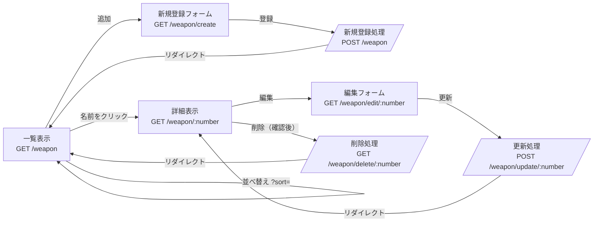

---

### 4.3 ギア参照システム

#### 4.3.1 データ構造

配列 `gear` の各要素は，次のオブジェクトである．初期データは19件．

| プロパティ | 型 | 内容 | 例 |
|---|---|---|---|
| `id` | 数値 | ID（自動で付ける） | 5 |
| `name` | 文字列 | ギア名 | ヤコバイザー |
| `part` | 文字列 | 部位（`GEAR_PARTS` から選ぶ） | アタマ |
| `brand` | 文字列 | ブランド（`BRANDS` から選ぶ） | ヤコ |
| `main` | 文字列 | ギアの効果（`ABILITIES` から選ぶ） | スーパージャンプ時間短縮 |

#### 4.3.2 リソース名と機能

| メソッド | リソース名 | 処理 | 表示（→はリダイレクト先） |
|---|---|---|---|
| GET | `/gear` | 一覧 | `gear.ejs` |
| GET | `/gear?sort=brand` | ブランドで並べ替えた一覧 | `gear.ejs` |
| GET | `/gear?sort=main` | ギアの効果で並べ替えた一覧 | `gear.ejs` |
| GET | `/gear/create` | 新規登録フォーム | `gear_new.ejs` |
| POST | `/gear` | 新規登録 | → `/gear` |
| GET | `/gear/:number` | 詳細 | `gear_detail.ejs` |
| GET | `/gear/edit/:number` | 編集フォーム | `gear_edit.ejs` |
| POST | `/gear/update/:number` | 更新 | → `/gear/:number` |
| GET | `/gear/delete/:number` | 削除 | → `/gear` |

- POSTで受け取るパラメータ：`name`，`part`，`brand`，`main`
- 並べ替えは `GEAR_SORT` で決めている．ブランドは五十音順（`localeCompare`），ギアの効果は `ABILITIES` の順である（図8）．

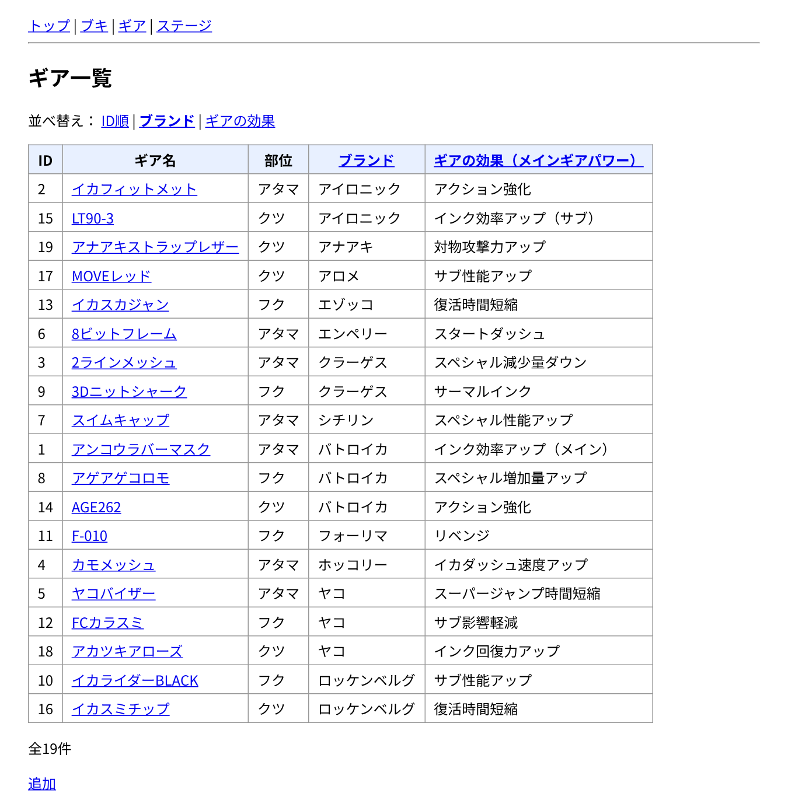

*図8 ブランドで並べ替えたギア一覧*

#### 4.3.3 ページ遷移図

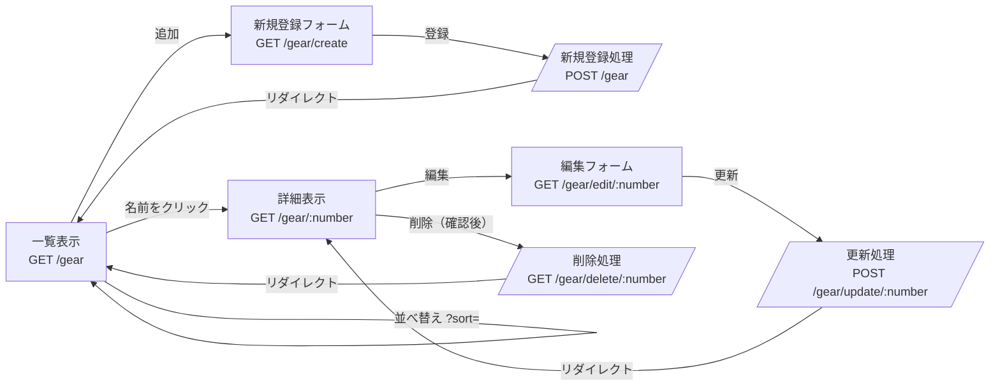

---

### 4.4 ステージ参照システム

#### 4.4.1 データ構造

配列 `stage` の各要素は，次のオブジェクトである．初期データは23件．

| プロパティ | 型 | 内容 | 例 |
|---|---|---|---|
| `id` | 数値 | ID（自動で付ける） | 13 |
| `name` | 文字列 | ステージ名 | クサヤ温泉 |
| `origin` | 文字列 | 初登場作品（`ORIGINS` から選ぶ） | スプラトゥーン3 |
| `added` | 文字列 | スプラトゥーン3への追加時期 | シーズン2 |
| `feature` | 文字列 | 特徴 | 温泉街。長い坂道での駆け引き |

#### 4.4.2 リソース名と機能

| メソッド | リソース名 | 処理 | 表示（→はリダイレクト先） |
|---|---|---|---|
| GET | `/stage` | 一覧 | `stage.ejs` |
| GET | `/stage/create` | 新規登録フォーム | `stage_new.ejs` |
| POST | `/stage` | 新規登録 | → `/stage` |
| GET | `/stage/:number` | 詳細 | `stage_detail.ejs` |
| GET | `/stage/edit/:number` | 編集フォーム | `stage_edit.ejs` |
| POST | `/stage/update/:number` | 更新 | → `/stage/:number` |
| GET | `/stage/delete/:number` | 削除 | → `/stage` |

- POSTで受け取るパラメータ：`name`，`origin`，`added`，`feature`
- 一覧には特徴を表示せず，詳細ページで表示する（図9）．
- 並べ替えの機能はない．ほかの2システムと同じテンプレートの形にするため，`sortList` を並べ替えなしで呼び出している．

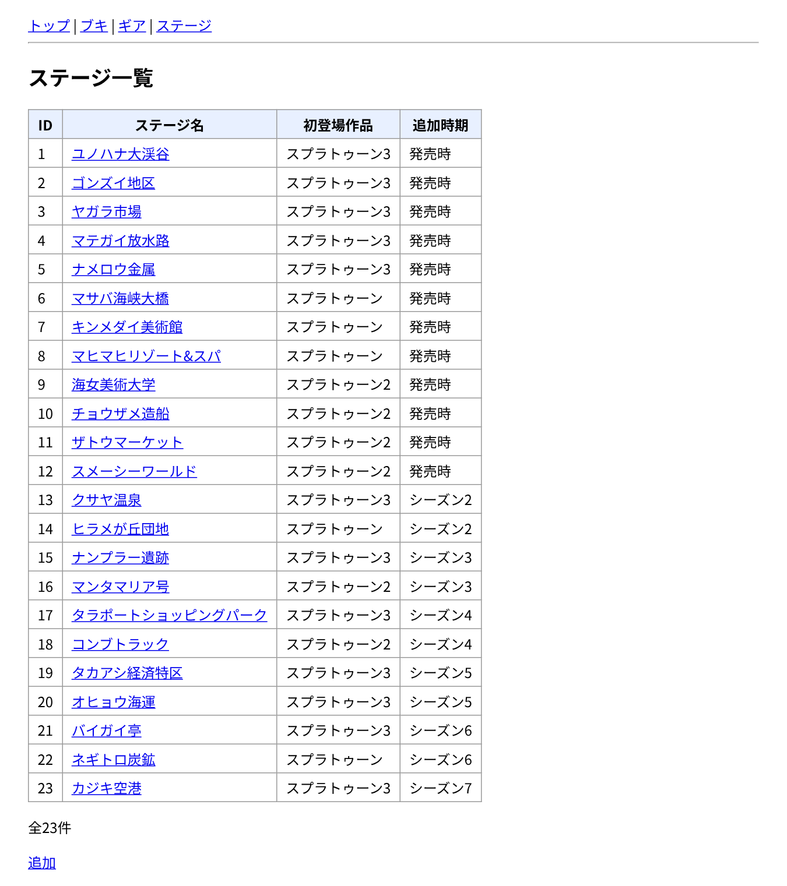

*図9 ステージ一覧*

#### 4.4.3 ページ遷移図

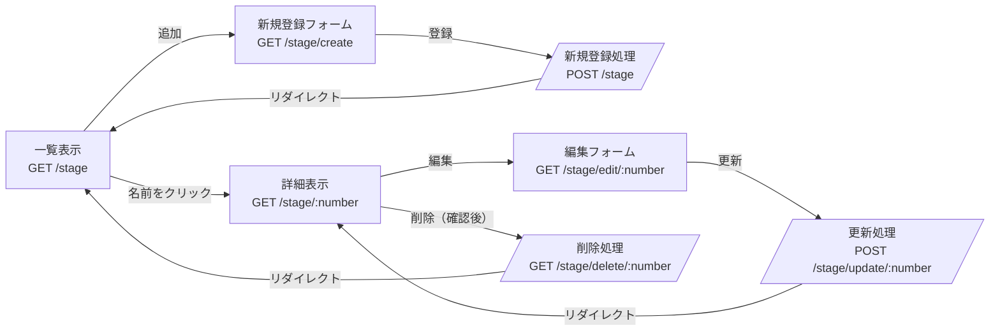

---

## 5. 授業で説明していない技術

| 技術 | 概要 | 採用理由 |
|---|---|---|
| 配列の `sort` と比較関数，`localeCompare` | `sort` は配列を並べ替えるメソッドで，2つの要素を比べる関数を渡すと好きな順番にできる．`localeCompare(相手, 'ja')` は日本語の文字列を辞書順で比べる． | 一覧を武器種・サブ・スペシャル・ブランド・ギアの効果で並べ替えるため． |
| EJSの `include` にデータを渡す | `<%- include('ファイル名', { data: {} }) %>` のように，読み込むテンプレートに値を渡せる． | 新規登録と編集の入力欄を1つのテンプレート（`XXX_form.ejs`）にまとめるため．新規登録のときは空のデータを渡す． |
| `<select>` と `<option selected>` | プルダウンで選択肢から選ばせるHTMLの部品．`selected` を付けた選択肢が，最初から選ばれた状態になる． | サブやスペシャルの名前を手で入力すると表記がばらつき，並べ替えが正しくできなくなるため．編集画面では今の値を選ばれた状態にする． |
| JavaScriptの `confirm()` | 「OK」「キャンセル」を選ぶ確認ダイアログを出す．リンクの `onclick` で `false` を返すと，ページを移動しない． | スライドに「本来は削除の確認ページを表示する」とあったため．間違えて削除しないよう確認を入れた． |
| `res.status(404)` | レスポンスのステータスコードを指定する． | 存在しないデータを開いたとき，「見つからない」ことをブラウザに正しく伝えるため． |
| 正規表現（`/^[0-9]+$/.test()`） | 文字列が決まった形に合うかを調べる．ここでは数字だけでできているかを調べる． | `:number` に数字以外が指定されたときに弾くため． |
| 外部CSSファイル | `<link rel="stylesheet">` で，全ページ共通の見た目を1つのファイルにまとめる． | 表に罫線を付けて見やすくし，3システムの見た目をそろえるため． |

---

## 参考にしたデータ

ブキ・ギア・ステージのデータは，次のWebサイトを参考にした（2026年11月27日に閲覧）．

- アルテマ「【スプラトゥーン3】武器(ブキ)一覧」 https://altema.jp/splatoon3/bukilist
- Game8「【スプラトゥーン3】頭(アタマ)の一覧」「服(フク)の一覧」「靴(クツ)の一覧」 https://game8.jp/splatoon3/480326 ほか
- スプラトゥーン3 攻略&検証 Wiki「ステージ」 https://wikiwiki.jp/splatoon3mix/
- ファミ通.com「スプラトゥーン3 ステージ紹介」 https://www.famitsu.com/news/202209/01273747.html
