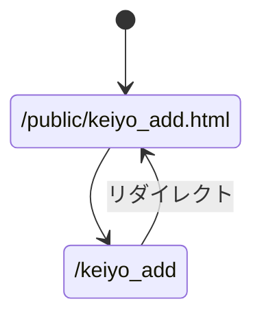
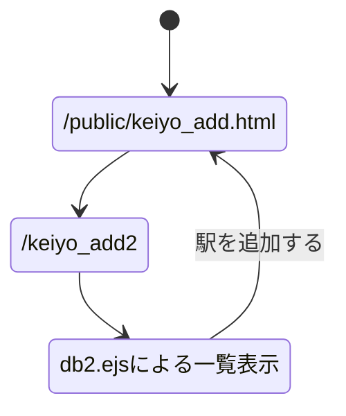
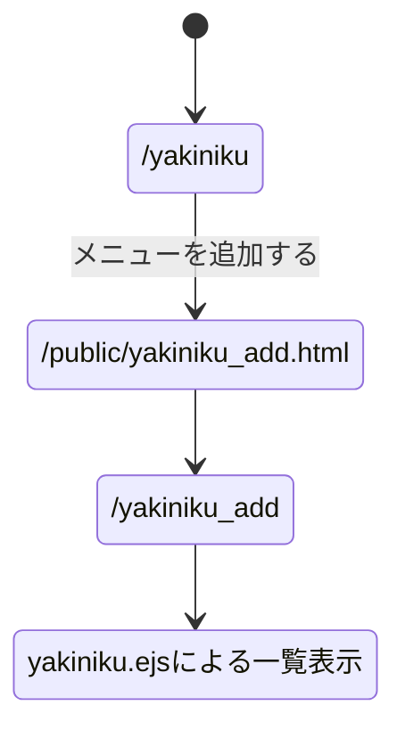

# 第8回 データの流れ　やってみよう

起動: `node app5.js` → http://localhost:8080/public/index.html

## (1) keiyo_add の追加と，登録後に返すページの比較

- `/public/keiyo_add.html` のボタンを2つにした
  - 「登録（入力画面に戻る）」→ `/keiyo_add` → `res.redirect('/public/keiyo_add.html')`（例1）
  - 「登録（一覧を表示）」→ `/keiyo_add2` → `res.render('db2', ...)`（例2）

| | データ入力画面に戻す（redirect） | データ一覧画面を出す（render） |
|---|---|---|
| 良い点 | 続けてどんどん入力できる | 追加できたかすぐ確認できる |
| 悪い点 | 本当に登録できたか分からない | 続けて入力するには入力画面へ戻る必要がある |

**結論：** 1件ずつ登録して確認したい今回のような用途では **データ一覧画面** の方が良い。
登録結果が目に見えるので安心でき，間違いにもすぐ気付ける。
大量のデータを連続で入力する場合は入力画面に戻す方が便利。

※ 一覧を render で返すとURLが `/keiyo_add2?...` のままなので，再読み込みすると同じデータがもう一度登録されてしまう点にも注意。

### ページ遷移図（例1：リダイレクト）


### ページ遷移図（例2：一覧表示）


## (2) 自分の興味のあるデータの一覧表示
- テーマ：焼肉のメニュー（項目：ID，メニュー名，部位，値段）
- データ：app5.js の `yakiniku` 配列
- 一覧：`/yakiniku` → `views/yakiniku.ejs`（表で表示）

## (3) (2)にデータ追加機能を追加
- 入力フォーム：`/public/yakiniku_add.html`（メニュー名・部位・値段）
- 処理：`/yakiniku_add`（IDは自動採番，追加後は一覧を表示）



## (4) GitHubへの登録
```
git add .
git commit -m "第8回 データの一覧表示と追加"
git push
```
