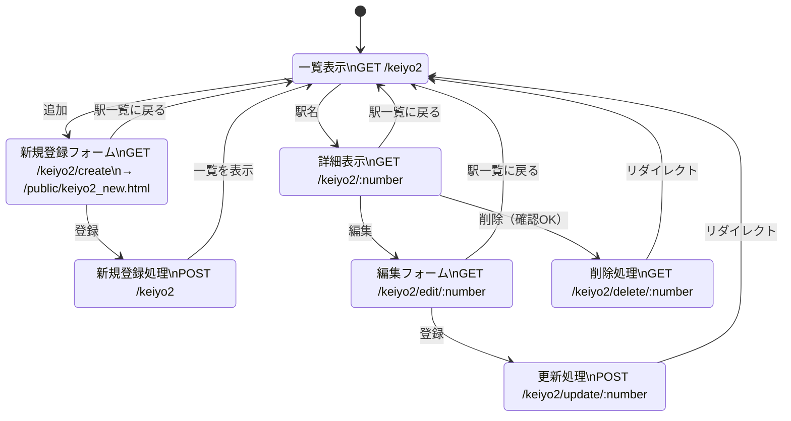

# 第10回 API（CRUD）　やってみよう

起動: `node app5.js` → http://localhost:8080/keiyo2

## (1) CRUのCRUの動作確認

| 機能 | method | リソース名 | 処理 |
|---|---|---|---|
| 一覧（Read） | GET | `/keiyo2` | `keiyo2.ejs` で一覧表示 |
| 新規登録フォーム（Create） | GET | `/keiyo2/create` | `/public/keiyo2_new.html` へリダイレクト |
| 新規登録処理（Create） | POST | `/keiyo2` | `req.body` から追加して一覧表示 |
| 詳細表示（Read） | GET | `/keiyo2/:number` | `keiyo2_detail.ejs` |
| 編集フォーム（Update） | GET | `/keiyo2/edit/:number` | `keiyo2_edit.ejs` |
| 更新処理（Update） | POST | `/keiyo2/update/:number` | 更新して `/keiyo2` へリダイレクト |
| 削除処理（Delete） | GET | `/keiyo2/delete/:number` | 削除して `/keiyo2` へリダイレクト |

- `/keiyo2/create` は `/keiyo2/:number` より **前** に書く（後ろだと `create` が `:number` として扱われる）
- POSTの値を `req.body` で受け取るため `app.use(express.urlencoded({ extended: true }));` が必要
- 先週までの機能（おみくじ・じゃんけん・サイコロ・挨拶・`/keiyo`・`/keiyo_add`・焼肉メニュー）も動作することを確認した

### スライドから変更した点
- `keiyo2_edit.ejs` の form の action を `data.id - 1` から `id`（配列の番号）に変更
  → 削除すると `id` と配列の番号がずれて，別の駅が更新されてしまうため
- 編集フォームの1行目が `name="code"` なのに `data.id` を表示していたので，駅コード（`data.code`）を表示するよう修正
- 詳細表示で ID 欄に `data.code` が出ていたので ID と駅コードを分け，乗降客数も表示
- `<input type="submit" values="登録">` → `value`（綴りの修正）

## (2) ページ遷移図（削除を含む）

削除は **詳細表示ページ** から実行する（確認ダイアログを出してから削除）。



## (3) 削除機能
- `app5.js` に `GET /keiyo2/delete/:number` を追加（`station2.splice(番号, 1)` で削除 → `/keiyo2` へリダイレクト）
- `keiyo2_detail.ejs` に「削除」リンクを追加（`confirm()` で確認）

## (1') (3') GitHubへの登録
```
git add .
git commit -m "第10回 CRUD（新規登録・編集・更新・削除）"
git push
```
